# Borderless

**An atlas of visa access between countries, from 2019 to today.**
Click a country to see where its passport takes you, how that changed through COVID-19 and the new
electronic travel authorisations, who gives back what they get, and which countries form visa blocs.

**Live demo: [borderless-tawny.vercel.app](https://borderless-tawny.vercel.app)**
(also in French: [borderless-tawny.vercel.app/?lang=fr](https://borderless-tawny.vercel.app/?lang=fr))

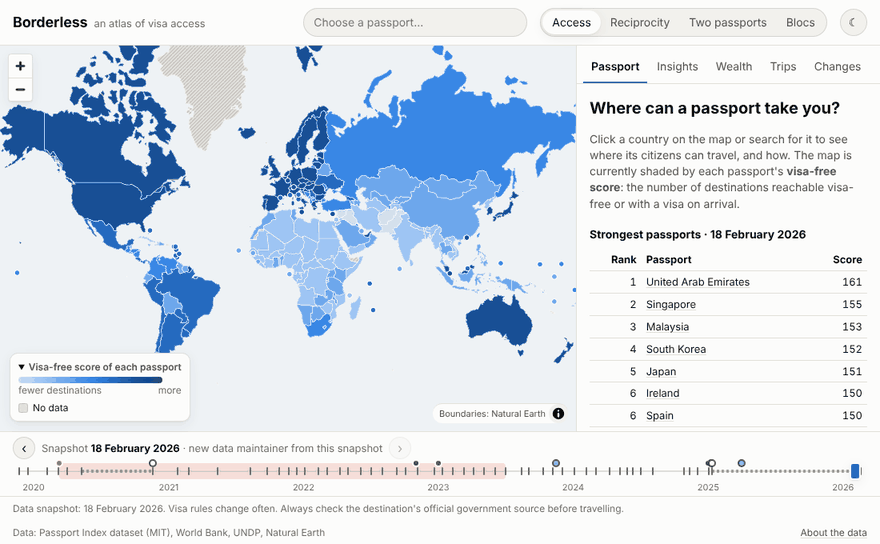

---

## Why I built this

Visa rules are one of the most unequal things about the world map, and they are surprisingly hard to look
at as data: the information is spread over embassy pages, published as rankings without the underlying
relationships, and it changes every month. I wanted a project that goes from messy public data to a
product someone can actually use, and that shows the parts of analytics work I enjoy most: modelling
the data carefully, testing it, questioning it, and explaining what it can and can't say.

Borderless is that project: a scheduled pipeline (Airflow, dbt, DuckDB, networkx) that rebuilds a
tested warehouse every month and exports static JSON for an interactive map.

## What you can do

| | |
|---|---|
| 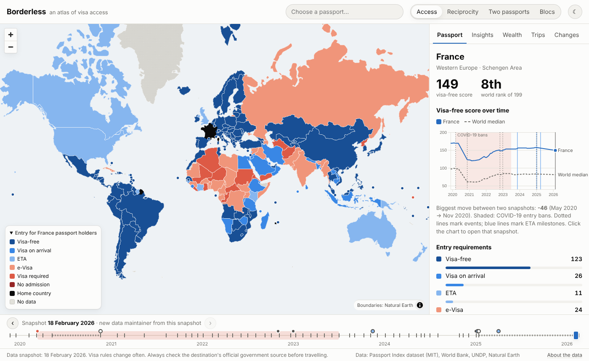 | **Where can a passport go?** Click a country (or search) and every other country is coloured by the entry requirement for that passport: visa-free (with days when known), visa on arrival, ETA, e-visa, visa required or no admission. The side panel shows the visa-free score, the world rank and every destination. The selected passport lives in the URL (`?passport=FRA`) so views are shareable. |
| 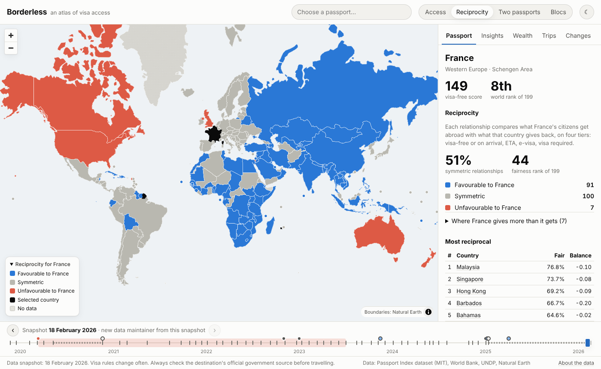 | **Reciprocity.** For the selected country, is each relationship symmetric, favourable or unfavourable? Plus a fairness ranking: Malaysia, Singapore and Hong Kong treat others most like they are treated; Canada and New Zealand get far more than they give. |
| 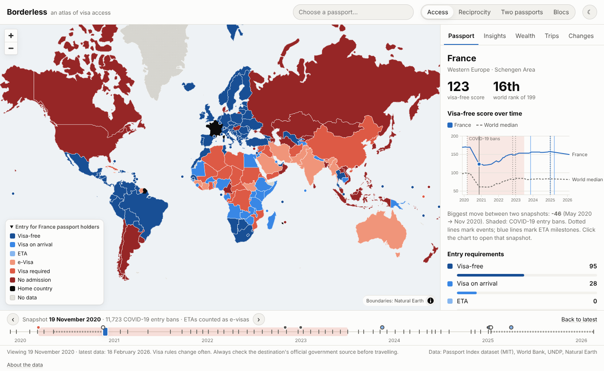 | **History.** A time slider over 54 snapshots (Nov 2019 → Feb 2026), proportional to real time so gaps in the data stay visible, with the COVID-19 bans and ETA milestones marked. The line chart compares a passport with the world median: the median score fell from 98 to 61 in November 2020 and was back to 85 by 2023. |
| 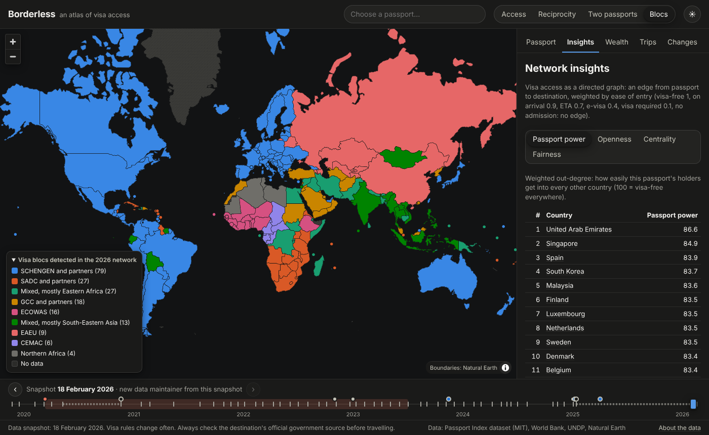 | **Network insights.** Rankings for passport power, openness, PageRank centrality and fairness, and a map of visa blocs found by community detection: the visa-free club around Schengen, SADC, ECOWAS, the GCC, the Eurasian Economic Union, CEMAC… |
| 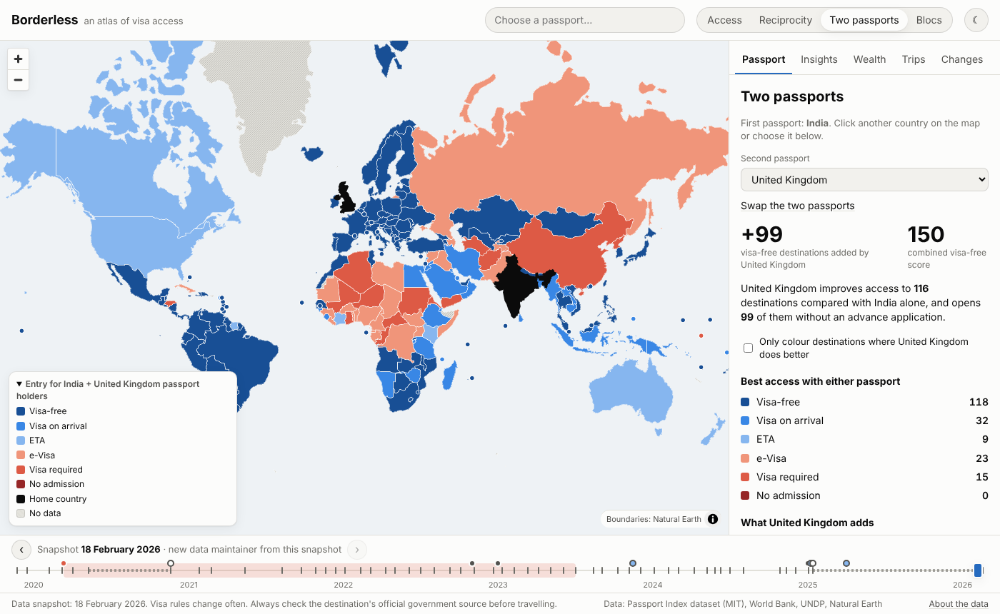 | **Two passports.** Pick two passports to see the best access with either one. An Indian passport holder who also holds a British passport gains 99 visa-free destinations. |
| 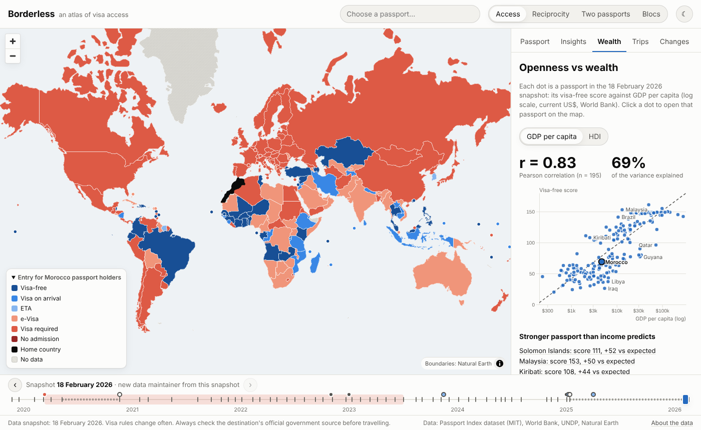 | **Openness vs wealth.** Visa-free score against GDP per capita (log scale, r = 0.83) or HDI (r = 0.81), with the outliers labelled: Malaysia and the Solomon Islands do much better than income predicts, Iraq and Qatar much worse. Click a dot to open that passport. |
| 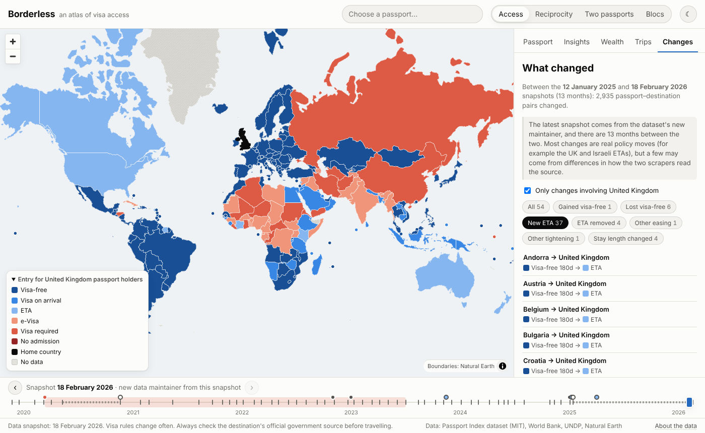 | **What changed** between the two latest snapshots: 727 pairs lost visa-free access and 414 gained a new ETA requirement (Suriname, Saint Kitts and Nevis and Israel account for most of them, and the UK ETA now reaches European visitors). Each row opens the pair on the map. There is also a **trip planner** that lists where you can go without applying for anything in advance, by region, longest stay first. |

On the first visit a short welcome pop-up explains the project, the questions it answers and how to
use the map; the **?** button in the top bar reopens it. The site is in **English and French**: it follows the browser's language, the EN/FR button switches
it, and links keep the choice (`?lang=fr`), so either version can be shared. Country names come from
Natural Earth's French names and the timeline events are translated in the dbt seed. It works in light
and dark mode, down to phone width, and with the keyboard. axe-core reports no violations on any view,
in either language.

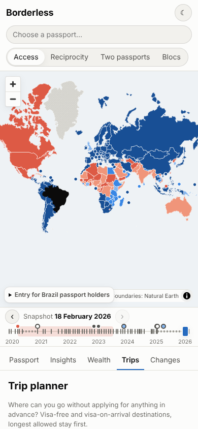

## Architecture

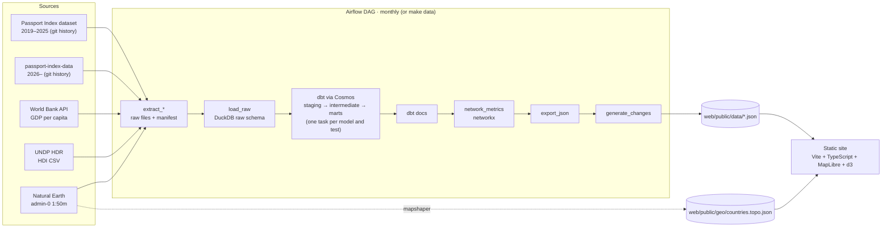

Every task that writes to the DuckDB file runs in a single-slot `duckdb_writer` Airflow pool, because
DuckDB allows one writer at a time. The extract tasks only write files, so they run in parallel. dbt is
installed in its own virtualenv inside the Airflow image (`/opt/dbt-venv`) so its pins never fight
Airflow's, and Cosmos calls it from there.

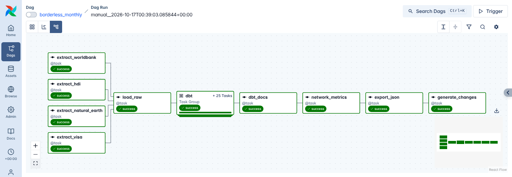

<p>
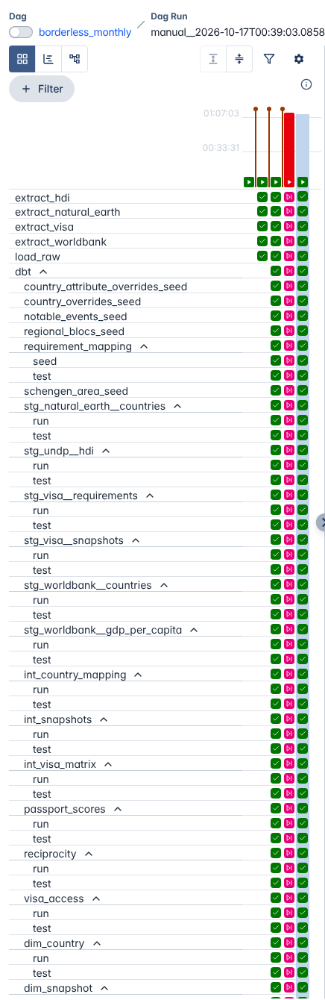

Cosmos renders every dbt seed, model run and model test as its own Airflow task (right), so a failing
test stops only what depends on it and shows up exactly where it failed. The `dbt` group in the graph
above expands into these tasks.

The dbt project has three layers:

- **staging**: one model per source, typed and cleaned (`stg_visa__requirements`, `stg_undp__hdi`, …)
- **intermediate**: `int_country_mapping` (ISO-3 codes across all sources), `int_visa_matrix`
  (every snapshot × passport × destination with a harmonised category), `int_snapshots`,
  `int_snapshot_history`
- **marts**: `passport_scores`, `reciprocity`, `fairness_scores`, `openness_vs_wealth`,
  `snapshot_changes`, `trip_planner`, `dim_country`, `dim_snapshot`, `visa_access`

68 dbt tests run on every build: not_null, unique, accepted_values on the categories, relationships from
every passport and destination to the country dimension, and singular tests (every snapshot is a complete
square matrix, every raw value maps to a category, reciprocity is mirrored, the 2019 and 2020 category
boundaries behave).
</p>

<br clear="right">

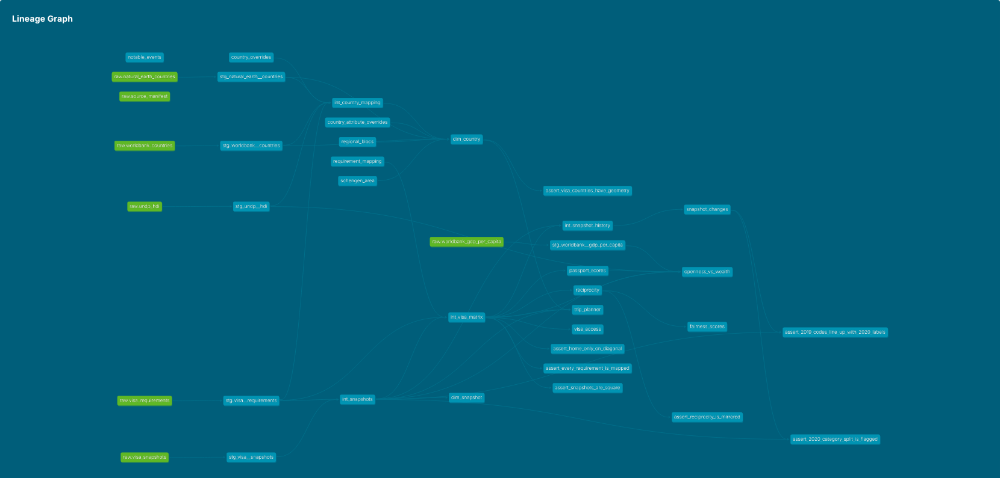

## Data sources and licences

| Data | Source | Licence |
|---|---|---|
| Visa requirements 2019–2025 | [ilyankou/passport-index-dataset](https://github.com/ilyankou/passport-index-dataset), scraped from passportindex.org | MIT |
| Visa requirements 2026– | [imorte/passport-index-data](https://github.com/imorte/passport-index-data), the successor named in the archived repo's README | MIT |
| GDP per capita (current US$, `NY.GDP.PCAP.CD`) | [World Bank API](https://data.worldbank.org/indicator/NY.GDP.PCAP.CD) | CC BY 4.0 |
| Human Development Index | [UNDP Human Development Report](https://hdr.undp.org/data-center/documentation-and-downloads), composite indices time series | CC BY 3.0 IGO |
| Country shapes | [Natural Earth](https://www.naturalearthdata.com/) admin-0 1:50m v5.1.2 | Public domain |

Every download is cached in `pipeline/raw/` and recorded in `pipeline/raw/_manifest.json` with its URL
and download date. Every JSON file shipped to the front-end carries a `snapshot_date`.

## Methodology

### Building a consistent history

The visa history comes from the dated `legacy/` folders of the first repository, plus every committed
version of the root CSV newer than the last folder, plus the same for its successor. That gives
54 snapshots from 23 November 2019 to 18 February 2026, read straight from git so each one is traceable to
a commit.

The categories were not stable over those six years, and most of the work was making them comparable.
A seed (`requirement_mapping.csv`) maps each raw value to a harmonised category *per value format*:

| Period | Raw values | How I map them |
|---|---|---|
| Nov–Dec 2019 | numeric codes 0–3, no day counts | 3 visa-free, 1 visa on arrival, 2 the mixed bucket below, 0 visa required |
| Feb–May 2020 | `VF`, `VOA`, `ETA`, `VR` + days | `ETA` is the mixed bucket below |
| Nov 2020–Dec 2024 | labels + days, ETAs counted as e-visas | as published; `covid ban` → no admission (flagged) |
| Jan 2025– | labels + days, `eta` separate | as published |

Three findings shaped the mapping, and each one is guarded by a dbt test:

1. **The 2019 codes 1 and 2 are the other way round from the README of the time.** Matching every pair
   against February 2020, code 2 lines up with `ETA` (8,264 pairs) and code 1 with `VOA` (718 pairs).
   With the README's mapping, 9,000 pairs "changed category" in two months.
2. **Before November 2020, one bucket mixed visas on arrival, ETAs and e-visas.** When the source split
   it, 75% of those pairs became visa on arrival and 24% e-visa. Mapping it to e-visa made scores *rise*
   during the COVID-19 bans, so I map it to visa on arrival (its majority) and flag it as approximate in
   the UI. Moves between those categories at that boundary are marked as methodology artefacts rather
   than policy changes.
3. **ETAs are only separate from 12 January 2025.** The 819 e-visa → ETA moves on that date are
   reclassifications, not new requirements.

### Metrics

- **Visa-free score**: destinations reachable visa-free or with a visa on arrival, i.e. without applying in
  advance. It is the one definition that holds across every snapshot. ETAs are always counted separately.
  **World rank** ranks the score, with ties sharing a rank.
- **Reciprocity** compares, for each pair, what A's citizens get in B with what B's citizens get in A, on
  four tiers: visa-free or on arrival, ETA, e-visa, visa required or no admission. **Fairness score** is the
  share of symmetric relationships; **balance** is (favourable − unfavourable) / partners, from −1 to 1.
  The browser computes these for any snapshot, and a test checks they match the dbt mart exactly.
- **Network**: a directed graph with an edge passport → destination weighted by ease of entry:
  visa-free 1.0, on arrival 0.9, ETA 0.7, e-visa 0.4, visa required 0.1, no admission no edge.
  - *Passport power* is the weighted out-degree and *openness* the weighted in-degree, both as % of the maximum.
  - *Centrality* is PageRank on the access graph: a country ranks high when it is easy to reach from
    passports that are themselves easy to reach.
  - *Blocs*: Louvain community detection on the mutual graph, where each pair is weighted by the
    weaker of its two directions. A single pass only separates the global visa-free club from the rest,
    so communities are split again recursively while the split keeps a modularity of at least 0.05.
    Near-cliques such as Schengen stay whole because any split of them scores close to zero.
  - Communities are labelled after the reference blocs they contain (`regional_blocs.csv`), and node
    ids are relabelled to integers so the result is reproducible across runs.
- **Openness vs wealth**: least-squares fit of the visa-free score on log₁₀ GDP per capita (and on HDI), using
  the latest value up to the snapshot year. Outliers are the largest residuals.
- **Changes**: every pair whose category or allowed stay changed between consecutive snapshots, typed as
  gained/lost visa-free, new ETA, ETA removed, other easing or tightening, or stay changed.

## Limitations

- **Conditional access can't be shown.** One category per pair can't express "visa-free if you hold a valid
  US or Schengen visa", "only at certain airports" or "only for tourism". The map shows the general rule,
  and the panel says so.
- **Schengen** stays are counted across the whole area (90 days in any 180), not per country. The map
  colours each member separately, so the tooltip and panel add a note.
- **Snapshots are irregular.** There are gaps in mid-2020 and between January 2025 and February 2026, and
  the latest comparison spans a change of data maintainer. Scores before November 2020 are approximate (see above).
- **Territories and disputed areas** missing from the visa data or the boundaries (Western Sahara, Northern
  Cyprus, Somaliland, overseas territories) are shown as "no data". Hong Kong, Macao, Taiwan, Palestine and
  Kosovo have their own entries. Boundaries follow Natural Earth's defaults and imply no position.
- GDP is missing for Taiwan and the Vatican, HDI for Macao, Taiwan, the Vatican and Kosovo. They are left out of
  the scatter plot and named under it.
- The source is a third-party scrape of passportindex.org. **Visa rules change often: always check the
  destination's official government source before travelling.** The site says this on every page.

## Running it

You need Python 3.11+, Node 22+, `git` and `make`. Docker is only needed for Airflow.

### The pipeline without Airflow

```bash
make setup   # .venv with dbt-core, dbt-duckdb and the pipeline package
make data    # extract → load → dbt build (models + tests) → network → export → changes
make test    # pytest: extractors, loader, network metrics, export, and an end-to-end run on fixture data
make dbt-docs  # generate the dbt docs and serve them on http://localhost:8081
```

`make data` takes about a minute on a laptop. Raw downloads younger than 20 days are reused; use
`make data-refresh` to force new downloads.

### The pipeline with Airflow

```bash
make airflow-up   # builds the image (Airflow 3 + Cosmos, dbt in /opt/dbt-venv) and starts it
```

Open http://localhost:8080, un-pause `borderless_monthly` and trigger it, or run it once from the
terminal with `make airflow-run`. The dbt project, the pipeline package, the DuckDB file and
`web/public/data` are bind-mounted, so the host and the containers share the same files. Stop it with
`make airflow-down`.

### The front-end

```bash
make web-dev     # http://localhost:5173
make web-test    # vitest: matrix decoding, URL state, reciprocity (checked against the dbt mart)
make web-build   # type-check and build the static site into web/dist
```

The exported JSON is committed, so the front-end runs without the pipeline. `web/dist` is plain static
files with relative paths: it can be served from a domain root or a sub-folder by any static host. The
first load is about 410 KB gzipped (most of it MapLibre). Older snapshots (about 13 KB each) and the
secondary tabs load only when needed.

### Hosting and data updates

The live site is hosted on [Vercel](https://borderless-tawny.vercel.app), connected to this repository
with these settings: root directory `web`, framework Vite, build command `npm run build`, output
directory `dist`, Node.js 22. Every push to `main` redeploys it.

Vercel only serves the JSON committed in `web/public/data`; it doesn't run the pipeline. To publish new
data I run the pipeline (`make data` or the Airflow DAG), then commit and push the exported files:

```bash
make data
git add web/public/data
git commit -m "data: refresh snapshot"
git push    # Vercel redeploys with the new data
```

## Project structure

```
airflow/dags/           the monthly DAG (Cosmos task group for dbt)
docker/airflow/         Airflow image: Cosmos + pipeline deps, dbt in its own virtualenv
pipeline/               extract, load, network metrics and JSON export (Python package + tests)
dbt/                    staging / intermediate / marts, seeds and tests
web/                    Vite + TypeScript front-end, exported data and simplified country shapes
docs/screenshots/       images used in this README
```

## Licence

MIT © 2026 Oussama Essalehi. The data keeps the licences listed above.
